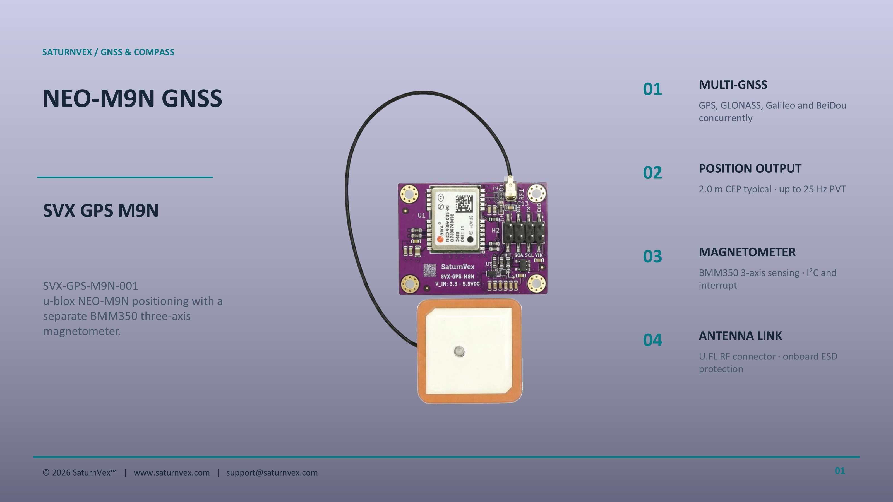
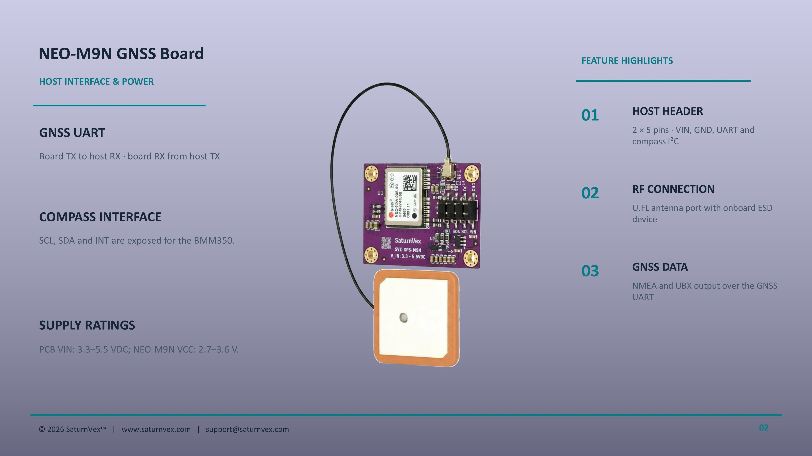
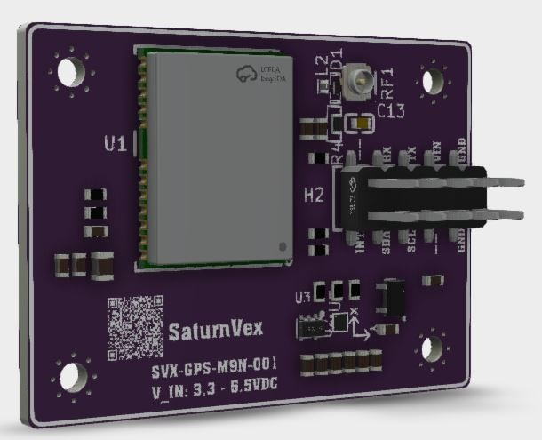

<strong>SATURNVEX · GNSS & COMPASS</strong>

<!-- Product cover images; GitHub constrains content to the README panel width. -->

# SVX-GPS-M9N — NEO-M9N GNSS & BMM350 Compass Board

*SaturnVex™ — embedded hardware, firmware and Edge AI platforms*

A compact multi-GNSS positioning board based on the u-blox NEO-M9N, with a separate Bosch BMM350 three-axis magnetometer for heading. The receiver tracks GPS, GLONASS, Galileo and BeiDou concurrently and outputs NMEA and UBX over UART; the magnetometer is exposed on I²C with an interrupt line. A Windows test tool verifies the receiver with any 3.3 V USB-UART adapter.

## Product specifications

| Item | Specification |
|---|---|
| Product code | `SVX-GPS-M9N-001` |
| GNSS receiver | u-blox NEO-M9N-00B, 92-channel; GPS, GLONASS, Galileo and BeiDou concurrently |
| Position performance | 2.0 m CEP typical, navigation rate up to 25 Hz (NEO-M9N datasheet figures; board performance depends on antenna and conditions) |
| Magnetometer | Bosch BMM350 three-axis, I²C with interrupt (INT) |
| Host interface | Header H2, 2 × 5 pins, 2.54 mm: VIN, GND, GNSS UART (TX / RX, 33 Ω series), BMM350 SCK / SDA / INT |
| GNSS UART | 3.3 V logic, default 38400 baud, NMEA + UBX protocols |
| Antenna | U.FL connector with onboard ESD protection and active-antenna bias |
| Power | VIN 3.3–5.5 VDC; onboard 3.3 V (AP2112K) and 1.8 V regulators |
| Test projects provided | GNSS receiver test tool for Windows (fix, DOP, accuracy, C/N0, TTFF, CEP statistics, CSV log); BMM350 magnetometer I²C test with an STM32G474 host |

## Documentation

| Resource | File |
|---|---|
| **Getting started (antenna, wiring, interfaces)** | [Open](docs/README.md) |
| **Test guides and packages** | [Browse tests](tests/README.md) |
| **Mechanical CAD** | [CAD files / STEP](cad/README.md) |
| **Download all available documentation and code** | [Download complete package](downloads/SVX-GPS-M9N-001_Complete_Resources.zip) |

## Test projects — documentation paired with source

| Test | Test guide (PDF) | Source (ZIP) | Overview |
|---|---|---|---|
| 01 — GNSS Receiver Test Tool (Windows, UART) | [Guide](tests/01-gnss-test-tool/SaturnVex_GPS_M9N_Test_Tool_Guide_EN.pdf) | [Source](tests/01-gnss-test-tool/GPS_M9N_Test_Tool_SaturnVex.zip) | [Open](tests/01-gnss-test-tool/README.md) |
| 02 — BMM350 Magnetometer (I²C) | [Guide (STM32G474 Test 08)](https://github.com/SaturnVex/SVX-MCU-STM32G474-001/blob/main/tests/08-bmm350-i2c2/SaturnVex_STM32G474_BMM350_Test_Guide_EN.pdf) | [Source (STM32G474 Test 08)](https://github.com/SaturnVex/SVX-MCU-STM32G474-001/raw/main/tests/08-bmm350-i2c2/STM32G474_BMM350_I2C2_SaturnVex.zip) | [Open](tests/02-bmm350-i2c/README.md) |

**Getting started:** wire header H2 to a 3.3 V USB-UART adapter, connect an active antenna, then run `setup.bat` and `run.bat` from the test package. The guide lists the expected open-sky results (TTFF, satellites, C/N0, HDOP, hAcc, CEP) and a test record form. For the BMM350 compass, connect H2 pins 6 / 8 / 10 to a microcontroller I²C bus and use the [BMM350 example of SVX-MCU-STM32G474-001](https://github.com/SaturnVex/SVX-MCU-STM32G474-001/tree/main/tests/08-bmm350-i2c2) (see [Test 02](tests/02-bmm350-i2c/README.md)).

## CAD data

Download the [STEP model](cad/SVX_GPS_M9N_001.step) for mechanical integration.

## Complete download

[**Download the test guide, test package, STEP CAD and cover images**](downloads/SVX-GPS-M9N-001_Complete_Resources.zip).

You can alternatively use **Code → Download ZIP** in GitHub to download the repository.

## Where to Buy

For availability, pricing and purchase inquiries, contact **[support@saturnvex.com](mailto:support@saturnvex.com)**.

## Notes

- The PDF describes a specific test setup and expected results, not a blanket certification claim. GNSS performance depends on the antenna, cable, enclosure and RF environment.
- SaturnVex source files are provided under the BSD-3-Clause license (`LICENSE.txt` in the package). Python, pyserial and the Bosch BMM350 SensorAPI keep their own licenses.
- u-blox is a trademark of u-blox AG; BMM350 is a product of Bosch Sensortec GmbH. SaturnVex is not affiliated with either company.
- All header I/O is 3.3 V logic. Connect the antenna and cables only with the board powered off.

---
© 2026 **SaturnVex™** · [www.saturnvex.com](https://www.saturnvex.com) · support@saturnvex.com
