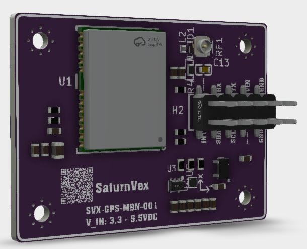

# Mechanical CAD

3D model of the SVX-GPS-M9N-001 GNSS board (u-blox NEO-M9N, U.FL antenna connector, 2 × 5 pin header H2, four mounting holes).
Verify connector positions, mounting holes and clearances from the STEP model before designing an enclosure.

- [Download STEP 3D CAD model](SVX_GPS_M9N_001.step?raw=true)
- [View CAD rendering](SVX_GPS_M9N_001_CAD_3D_View.jpg)

[← Product home](../README.md)
