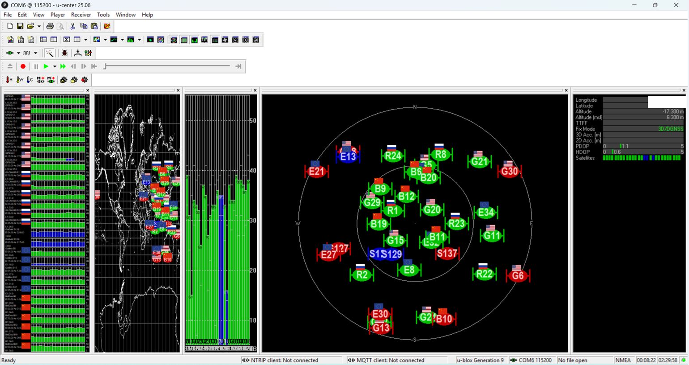
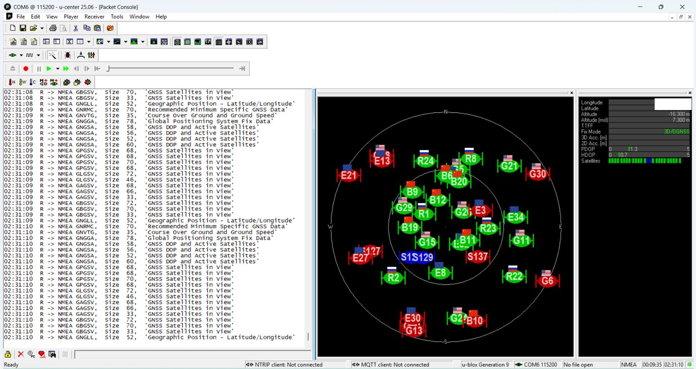
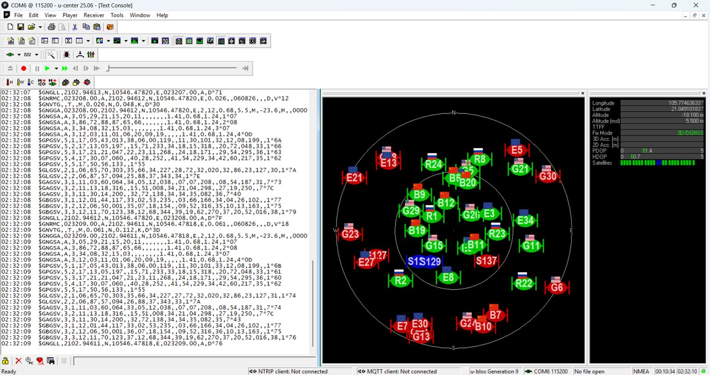
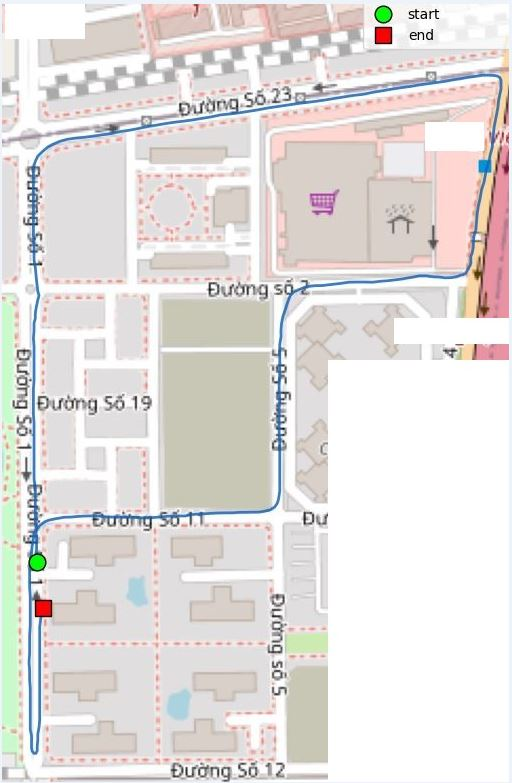

# GNSS Test Results (u-blox u-center)

**Board:** `SVX-GPS-M9N-001` · **Receiver:** u-blox NEO-M9N (Generation 9) · **Tool:** u-blox u-center 25.06 · **Link:** UART, 115200 baud, NMEA

Screenshots of a live test of this board with u-blox u-center, plus a recorded track. The receiver tracks GPS, GLONASS, Galileo, BeiDou and SBAS together and reaches a **3D/DGNSS** fix with PDOP ≈ 1.1–1.4 and HDOP ≈ 0.6–0.7.

**Download all images:** [GPS_M9N_uCenter_Images_SaturnVex.zip](./GPS_M9N_uCenter_Images_SaturnVex.zip)

## 1. Satellite view and fix status

Signal-strength bars, world map, sky view and navigation data. Fix mode 3D/DGNSS, PDOP 1.1, HDOP 0.6.

## 2. Packet Console

NMEA message stream from the receiver: GGA, GLL, RMC, VTG, GSA and GSV for each constellation (GP, GL, GA, GB, GN).

## 3. Text Console

Raw NMEA sentences with the position solution, DOP values and satellites in view.

## 4. Recorded track

Track recorded with the board while moving, from start (green) to end (red), plotted on a street map.

[← All tests](../README.md) · [← Product home](../../README.md)
